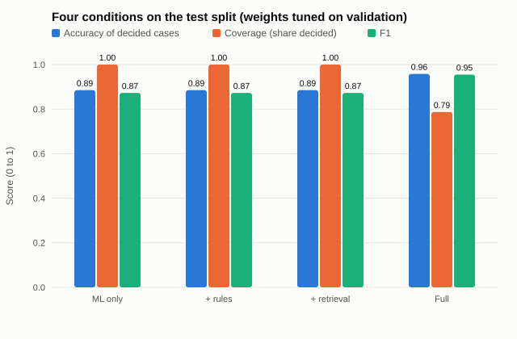
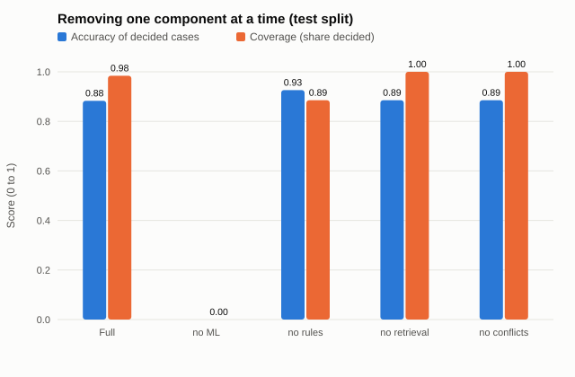
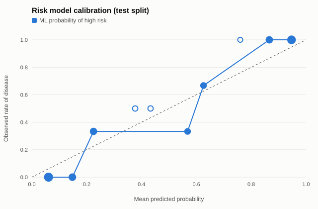
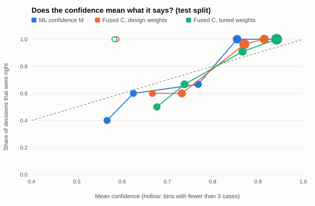

# MedIntel Stage II evaluation

Generated by `uv run medintel evaluate` on 2026-10-18. Research prototype on public de-identified data (UCI Heart Disease) and synthetic sample batches; not a clinical study.

## Configuration

- Risk model: risk-lr-uci 1.0.0 (36286f9d)
- Rulebase 1.0.0; knowledge index: medintel-starter-kb 1.0.0-draft (ff6c9a43)
- Retrieval: embedding similarity (sentence-transformers/all-MiniLM-L6-v2, cosine, numpy inner-product index)
- Summaries: template (deterministic; Claude summaries are evaluated by eval-writer)
- Data: UCI Cleveland, stratified 60/20/20, seed 2026: 61 validation, 61 test; plus the 24 bundled sample cases for latency and completeness
- Fusion, design weights: alpha 0.5, beta 0.3, gamma 0.2, lambda 0.5, threshold 0.6
- Fusion, tuned on the validation split: alpha 0.65, beta 0.3, gamma 0.05, lambda 0.5, threshold 0.739

## Results against the targets of Table 7.1

As the plan requires, the fusion weights and threshold were tuned on the validation split only and are judged here on the test split; results with the illustrative design weights are given in brackets.

| Metric | Target | Result | Met |
|---|---|---|---|
| F1 | Full pipeline above ML only | 0.955 vs 0.873; the full pipeline decides 79% (design weights: 0.873, 98%) | yes |
| ROC-AUC | Full pipeline not below ML only | 0.975 vs 0.975 | yes |
| Calibration error | Fused C no worse than the ML confidence | ECE 0.075 vs 0.088 (design weights: 0.101) | yes |
| Evidence precision at 5 | Reported; every cited passage has a valid source_id | pending the team's labels; valid IDs 100% | pending |
| Disagreement rate | Reported for each condition | ML only: 0%, ML + rules: 0%, ML + rules + retrieval: 12%, Full pipeline: 12% | yes |
| Rule false-alert rate | Reported per rule (validation split) | R-001 0 of 1; R-002 fired 61 (flag); R-003 fired 0 (scope rule); R-004 fired 0 (flag) | yes |
| Report completeness | 100% pass the schema | 100% of 146 reports | yes |
| End-to-end latency | 30 s per case; ML and rules under 1 s | worst case 0.13 s with the template writer; the Claude writer adds 6.38 s on average, 7.19 s at most (24 live cases); ML max 0.1 ms, rules max 0.1 ms | yes |
| Per-case cost | Reported | about $0.023 per case live and $0.011 per case with the Batch API (claude-opus-5-5, effort low) | yes |
| Explanation rubric | Mean of at least 4 per criterion | pending reviewer scores | pending |
| Planned test cases | All twelve pass | 12 of 12 pass | yes |

## 1. Planned test cases (Table 6.4)

| Test case | Result |
|---|---|
| TC-01 | pass |
| TC-02 | pass |
| TC-03 | pass |
| TC-04 | pass |
| TC-05 | pass |
| TC-06 | pass |
| TC-07 | pass |
| TC-08 | pass |
| TC-09 | pass |
| TC-10 | pass |
| TC-11 | pass |
| TC-12 | pass |

Each is a named test in `tests/test_planned_cases.py`; the docstrings quote the plan.

## 2. Four conditions on the test split (Table 7.1)

Classification metrics count the cases a condition decides; coverage is the share it decides. Only the full pipeline abstains (uncertain cases go to a clinician), so its accuracy and F1 cover fewer cases.

| Condition | Weights | Coverage | Accuracy | Precision | Recall | Specificity | F1 | ROC-AUC | Brier (C) | ECE (C) | Disagreement |
|---|---|---|---|---|---|---|---|---|---|---|---|
| ML only | design | 100% | 0.885 | 0.889 | 0.857 | 0.909 | 0.873 | 0.975 | 0.071 | 0.088 | 0% |
| ML only | tuned | 100% | 0.885 | 0.889 | 0.857 | 0.909 | 0.873 | 0.975 | 0.071 | 0.088 | 0% |
| ML + rules | design | 100% | 0.885 | 0.889 | 0.857 | 0.909 | 0.873 | 0.975 | 0.078 | 0.074 | 0% |
| ML + rules | tuned | 100% | 0.885 | 0.889 | 0.857 | 0.909 | 0.873 | 0.975 | 0.076 | 0.070 | 0% |
| ML + rules + retrieval | design | 100% | 0.885 | 0.889 | 0.857 | 0.909 | 0.873 | 0.975 | 0.082 | 0.102 | 12% |
| ML + rules + retrieval | tuned | 100% | 0.885 | 0.889 | 0.857 | 0.909 | 0.873 | 0.975 | 0.077 | 0.073 | 12% |
| Full pipeline | design | 98% | 0.883 | 0.889 | 0.857 | 0.906 | 0.873 | 0.975 | 0.086 | 0.101 | 12% |
| Full pipeline | tuned | 79% | 0.958 | 0.955 | 0.955 | 0.962 | 0.955 | 0.975 | 0.080 | 0.075 | 12% |

## 3. Component ablation (design weights, test split)

| Pipeline | Coverage | Accuracy | F1 | Brier (C) | ECE (C) |
|---|---|---|---|---|---|
| Full pipeline | 98% | 0.883 | 0.873 | 0.086 | 0.101 |
| without ML | 0% | n/a | n/a | 0.104 | 0.037 |
| without rules | 88% | 0.926 | 0.920 | 0.090 | 0.124 |
| without retrieval | 100% | 0.885 | 0.873 | 0.078 | 0.074 |
| without conflict detection | 100% | 0.885 | 0.873 | 0.082 | 0.102 |

## 4. Calibration (test split)

- ML probability of high risk against the outcome: ECE 0.094.
- Confidence in the decision against whether the decision was right: ML confidence M 0.088, fused C with design weights 0.101, with tuned weights 0.075.

| Bin | n | Mean predicted | Observed |
|---|---|---|---|
| 0.0-0.1 | 17 | 0.061 | 0.0 |
| 0.1-0.2 | 7 | 0.148 | 0.0 |
| 0.2-0.3 | 6 | 0.225 | 0.333 |
| 0.3-0.4 | 2 | 0.377 | 0.5 |
| 0.4-0.5 | 2 | 0.433 | 0.5 |
| 0.5-0.6 | 3 | 0.568 | 0.333 |
| 0.6-0.7 | 3 | 0.626 | 0.667 |
| 0.7-0.8 | 1 | 0.76 | 1.0 |
| 0.8-0.9 | 6 | 0.866 | 1.0 |
| 0.9-1.0 | 14 | 0.947 | 1.0 |

## 5. Rule alerts (validation split)

| Rule | Action | Fired | False-alert rate | Note |
|---|---|---|---|---|
| R-001 | elevate | 1 | 0% |  |
| R-002 | flag | 61 | n/a | data-completeness or scope flag, not a risk alert |
| R-003 | suppress | 0 | n/a | scope rule |
| R-004 | flag | 0 | n/a | data-completeness or scope flag, not a risk alert |

UCI records carry no creatinine, resting heart rate or patients under 18, so R-002 flags every case and R-003 and R-004 never fire here; the planned test cases and `boundary_tests.csv` check every rule at its boundary.

## 6. Latency and throughput (Section 6.5.1, TC-11)

Cold start: building the pipeline took 0.001 s and the first case 3.596 s (loading the embedding model and building the index).

| Stage | Median ms | p95 ms | Max ms |
|---|---|---|---|
| ml | 0.1 | 0.1 | 0.1 |
| rules | 0.0 | 0.0 | 0.1 |
| retrieval | 12.05 | 14.6 | 129.1 |
| context | 0.7 | 0.8 | 0.8 |
| fusion | 0.0 | 0.0 | 0.0 |
| total | 13.2 | 15.7 | 130.1 |

| Parallel workers | Cases per minute |
|---|---|
| 1 | 5023.8 |
| 2 | 4927.8 |
| 4 | 4227.8 |
| 8 | 4841.3 |

Times are for the template summary writer on this machine. A Claude-written summary adds the API call: 6.38 s on average and 7.19 s at most over 24 live cases (section 9).

## 7. Report completeness and statement tracing (Section 6.5.3)

- 146 reports checked against the DecisionReport schema: 100% pass.
- 903 summary sentences; 0 removed by the TC-12 check; 100% of the kept sentences cite a source. Writers: template.
- 618 evidence citations, 100% with a valid source_id; 0 cases had no evidence above the threshold (K = 0).

## 8. Evidence precision at 5

Pending: run `uv run medintel export-labels`, mark each retrieved passage in `reports/labeling/evidence_relevance.csv` as relevant (1) or not (0), and run `medintel evaluate` again.

## 9. Summary writer: cost, latency and removed statements

All rows use claude-opus-5-5 with prompt version 9820e7c4.

| Effort | Mode | Cases | Fallbacks | Removed sentences | Cost per case | Mean latency s | Max latency s |
|---|---|---|---|---|---|---|---|
| low | Batch API | 85 | 0 | 3 | $0.01098 | n/a | n/a |
| medium | Batch API | 85 | 0 | 3 | $0.01413 | n/a | n/a |
| low | live | 24 | 0 | 0 | $0.02299 | 6.38 | 7.19 |

Batch API rows are billed at half the standard price and carry no per-case latency; live rows call the Messages API as the server does, four cases at a time. Removed sentences are those the TC-12 check took out before the report was written.

## 10. Explanation rubric (Section 7.2)

Pending: reviewers score each report in `reports/labeling/explanation_rubric.csv` from 1 to 5 for completeness, factual consistency and usefulness, and time their reading (target: two minutes, NFR7).

## Reading these results

- The test split has 61 patients, so differences of a few points are within noise.
- UCI patients rarely trigger a rule override or a conflict, so the rule engine's value shows in the safety and boundary tests rather than in these averages; the fusion weights for R and D could not be tuned on this data (see reports/fusion_tuning.json).
- Coverage and accuracy trade off through the threshold; the team chooses the operating point.
